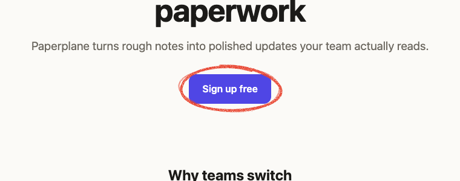
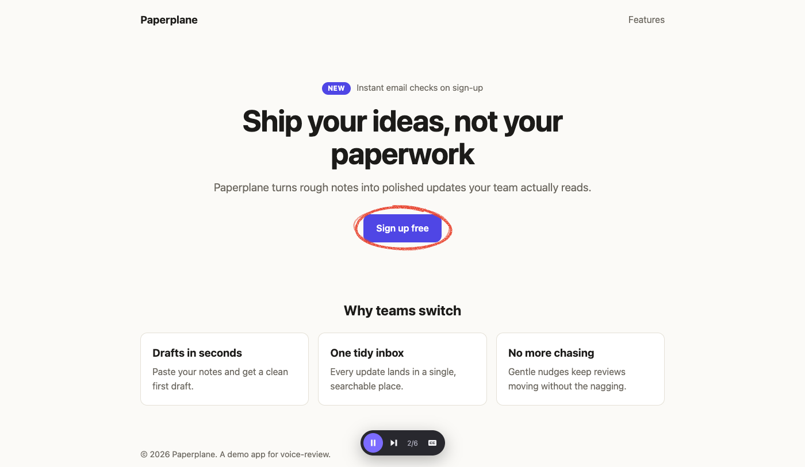
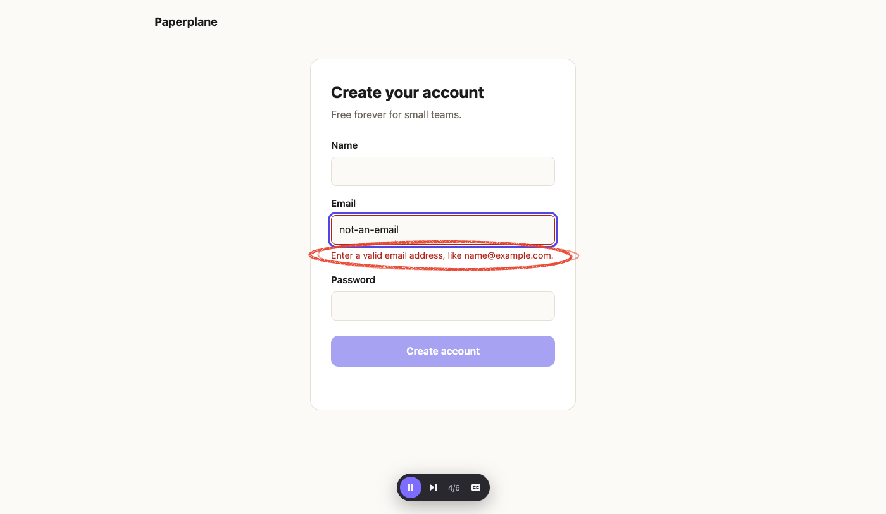
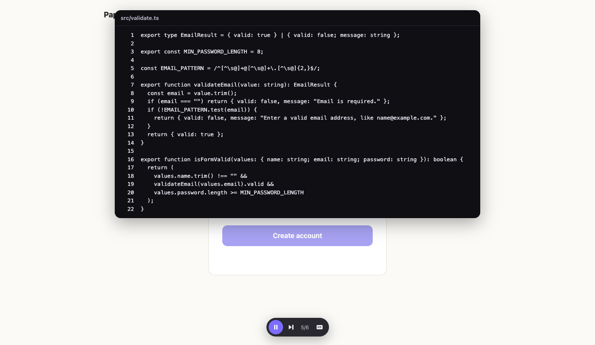

# explain-yourself

**Your coding agent shows you what it changed, out loud.**

An agent skill that opens your app in Chrome, circles each change with a hand-drawn pencil loop, and explains it in a voice, one step at a time.



## Why I built it

Almost nobody writes code by hand anymore, and almost nobody reads it either. Agents do the work, then hand you a neat summary: "✅ Updated the form, ✅ added validation, ✅ refactored X". It sounds complete, but you still don't really know what happened, or where it lives in the actual product.

I have ADHD and I'm a very visual person. A wall of text about a change is the hardest possible way for me to understand it. What I wanted was the way a teammate would show me:

> "Look here, this button changed. Now watch what happens when you type a bad email."

So this skill makes the agent do exactly that. It doesn't tell you what it did, it shows you, on your running app, with a voice. You can follow along, pause, or skip.

## Install

```bash
npx skills add fayazara/explain-yourself
```

Then, after your agent changes a web app (with the dev server running), ask it to **explain yourself**, or run `/explain-yourself`.

Needs Node 18+ and Google Chrome. The first run installs one small dependency (`playwright-core`) by itself.

## What you get

**UI changes get circled.** The page scrolls to the change, a pencil loop draws itself around it, and the voice explains what changed and why it matters.



**Interactions are acted out.** For behaviour changes, the tour does the steps itself. Here it types a bad email, then circles the error that now shows up straight away.



**Changes with nothing to see on screen show the code.** A logic change shows the relevant lines while the voice explains it.



**You're in control.** A small pill floats at the bottom with play/pause, next and a transcript toggle (CC). Drag it anywhere. Space pauses, ← and → move between steps.

## How it works

1. **The agent writes a tour.** It reads its own diff and writes `.explain-yourself/tour.json`: 3-8 short steps, ordered by what you'll see. Each step points at a changed element (or a few lines of code) and has one or two spoken sentences.

   ```json
   {
     "title": "Instant email feedback on sign-up",
     "url": "http://localhost:5173",
     "steps": [
       { "title": "A friendlier call to action", "page": "/",
         "point": "role=link[name=\"Sign up free\"]",
         "say": "The main button now reads Sign up free. Naming the price removes a reason to hesitate." },
       { "title": "Errors as you type", "page": "/signup",
         "do": [{ "fill": "role=textbox[name=\"Email\"]", "value": "not-an-email" }],
         "point": "text=valid email",
         "say": "A bad email shows an error right away, not after you press submit." },
       { "title": "One small validation function", "file": "src/validate.ts", "lines": "1-22",
         "say": "All the rules live in one small function that's easy to test." }
     ]
   }
   ```

2. **The agent plays it.** It runs `node scripts/show.mjs .explain-yourself/tour.json`, which opens Chrome on your dev server. For each step, the script goes to the page, finds the element with a Playwright locator, draws the pencil circle around it, and plays the narration.

3. **You watch, and ask for changes if you want any.** Tell the agent what to change, and it can replay the tour afterwards.

That's the whole thing: one `SKILL.md` the agent follows, and two small scripts (`show.mjs` runs the tour, `overlay.js` draws the circle and the pill). There's no app, no extension and no server to install.

## A better voice (optional)

By default the tour uses your browser's built-in voice. For a natural one, add an [ElevenLabs](https://elevenlabs.io) key once, in your own terminal:

```bash
node ~/.claude/skills/explain-yourself/scripts/show.mjs --setup
```

Use the folder your agent installed the skill into. Setup asks for the key (hidden as you type), a voice id and a model, and saves them to `~/.explain-yourself/config.json`, which only you can read. The environment variables `ELEVENLABS_API_KEY`, `ELEVENLABS_VOICE_ID` and `ELEVENLABS_MODEL` override the saved values. Audio clips are cached, so replays are instant and don't use credits.

**Privacy:** everything runs on your machine. If you set up ElevenLabs, only the narration sentences are sent to it.
